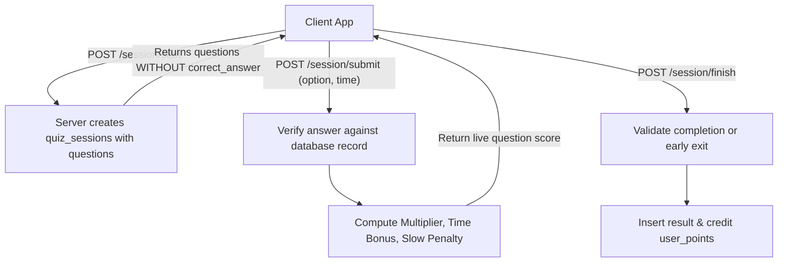

# kGamify Backend API Documentation
**Version:** 1.1.0  
**Specification:** OpenAPI 3.0 / RESTful  
**Framework:** Fastify v5 + TypeScript + Zod  
**Base URL (Local):** `http://localhost:5001/api/v1`  
**Swagger UI:** `http://localhost:5001/documentation`

---

## Table of Contents
1. [Architecture & Protocol Overview](#1-architecture--protocol-overview)
2. [Authentication & Authorization](#2-authentication--authorization)
3. [Global Response & Error Envelope](#3-global-response--error-envelope)
4. [Rate Limiting Policy](#4-rate-limiting-policy)
5. [Endpoints Specification](#5-endpoints-specification)
   - [5.1 System & Health](#51-system--health)
   - [5.2 Authentication & Phone Verification (`/auth`)](#52-authentication--phone-verification-auth)
   - [5.3 Users & Profiles (`/users`)](#53-users--profiles-users)
   - [5.4 Server-Authoritative Quiz Engine (`/quiz`)](#54-server-authoritative-quiz-engine-quiz)
   - [5.5 Championships & Discovery Feed (`/championships`)](#55-championships--discovery-feed-championships)
   - [5.6 Question Bank Management (`/questions`)](#56-question-bank-management-questions)
   - [5.7 Teacher Portal (`/teacher`)](#57-teacher-portal-teacher)
   - [5.8 Super Admin Governance (`/admin`)](#58-super-admin-governance-admin)
   - [5.9 Advertisements Engine (`/ads`)](#59-advertisements-engine-ads)
   - [5.10 Support, Queries & Feedback (`/support`)](#510-support-queries--feedback-support)
6. [Server-Authoritative Gameplay & Scoring Engine](#6-server-authoritative-gameplay--scoring-engine)
7. [Ad Placement Specifications](#7-ad-placement-specifications)
8. [Interactive Testing with Swagger UI](#8-interactive-testing-with-swagger-ui)
9. [Championship Maker Portal Integration](#9-championship-maker-portal-integration)

> **Contract status markers.** The Championship Maker portal (Next.js frontend in this repository) depends on a few additions that are not yet in the live API. These are marked **🚧 Portal requirement** below. Until the backend implements them, the portal falls back to existing data or shows an error for that action. See [§9.4](#94-pending-backend-changes-checklist) for the full checklist.

---

## 1. Architecture & Protocol Overview

The **kGamify** backend is built on high-performance Fastify v5 with strict Zod type compilation and serialization. All database operations interface with MySQL/MariaDB using connection pooling and transactions.

### Key Security & Architectural Guardrails
- **Zero Client Answer Exposure (Fixes VULN-01 & VULN-02):** Question delivery endpoints never return `correct_answer`. Scoring, bonus calculation, speed penalties, and coin grants are executed exclusively on the server.
- **Strict IDOR Mitigation (Fixes VULN-04):** Authenticated user endpoints derive identity exclusively from verified JWT access tokens (`request.user.id`), ignoring client-supplied user identifiers in payloads or queries.
- **Bcrypt Password Security & Transparent Upgrades (Fixes VULN-05):** Passwords hashed with Bcrypt (12 rounds). Legacy MD5/plaintext credentials transparently re-hash upon next successful login.
- **Cryptographic Password Resets (Fixes VULN-03):** One-time 32-byte cryptographic tokens with SHA-256 database hashing and 15-minute expiration windows.
- **Role-Based Access Control (RBAC):** Distinct roles: `user`, `teacher`, `director`, and `superadmin`.

---

## 2. Authentication & Authorization

### Bearer Token
Protected endpoints require an `Authorization` header containing a valid JSON Web Token (JWT):
```http
Authorization: Bearer <jwt_access_token>
```

### JWT Payload
```json
{
  "id": 42,
  "email": "user@example.com",
  "role": "user",
  "username": "suyog_player",
  "iat": 1729850000,
  "exp": 1729853600
}
```

### Supported Roles
| Role | Access Scope |
| :--- | :--- |
| `user` | Mobile player profile, gameplay sessions, feed, points, streaks |
| `teacher` | Question authoring, championship creation, student analytics |
| `director` | Academic department supervision |
| `superadmin` | Global institutes, ads, economy configs, teacher verification |

---

## 3. Global Response & Error Envelope

All API endpoints return JSON conforming to the standardized `ApiResponse<T>` interface:

### Success Response Envelope (HTTP 200, 201)
```json
{
  "success": true,
  "message": "Operation completed successfully",
  "data": { ... },
  "timestamp": "2026-10-25T10:15:30.123Z"
}
```

### Failure Response Envelope (HTTP 400, 401, 403, 404, 429, 500)
```json
{
  "success": false,
  "message": "Validation failed",
  "error": [
    {
      "code": "invalid_type",
      "expected": "string",
      "received": "undefined",
      "path": ["email"],
      "message": "Invalid email address"
    }
  ],
  "timestamp": "2026-10-25T10:15:30.123Z"
}
```

### HTTP Status Code Reference
| Code | Meaning | Reason |
| :--- | :--- | :--- |
| `200 OK` | Success | Request processed and data returned |
| `201 Created` | Resource Created | Entity (user, championship, question) created |
| `400 Bad Request` | Client Error | Payload schema validation error or invalid business state |
| `401 Unauthorized` | Unauthenticated | Missing, invalid, or expired JWT token |
| `403 Forbidden` | Access Denied | Role permissions insufficient or resource ownership mismatch |
| `404 Not Found` | Not Found | Requested entity does not exist |
| `429 Too Many Requests`| Rate Limited | Exceeded per-route or global rate threshold |
| `500 Server Error` | Internal Error | Unhandled runtime exception |
| `503 Service Unavailable`| Degraded | Database connectivity check failure |

---

## 4. Rate Limiting Policy

| Target Endpoint | Rate Limit | Time Window | Protection |
| :--- | :--- | :--- | :--- |
| **Global Default** | 100 requests | 1 minute | DDoS & brute-force mitigation |
| `POST /api/v1/auth/otp/send` | 5 requests | 10 minutes | Email/SMS spam protection |
| `POST /api/v1/auth/forgot-password` | 5 requests | 15 minutes | Enumeration & mail exhaustion prevention |
| `POST /api/v1/auth/phone/send-otp` | 3 requests | 10 minutes | SMS gateway toll fraud mitigation |
| `POST /api/v1/auth/phone/verify-otp`| 5 requests | 5 minutes | OTP brute-force prevention |
| `POST /api/v1/support/contact` | 5 requests | 10 minutes | Contact spam protection |

---

## 5. Endpoints Specification

### 5.1 System & Health

#### `GET /health`
- **Description:** System liveness & MySQL database connectivity probe.
- **Auth:** None (Public)
- **Response `200 OK`:**
```json
{
  "status": "UP",
  "database": "connected",
  "uptime": 1420.54,
  "timestamp": "2026-10-25T10:15:30.123Z"
}
```
- **Response `503 Service Unavailable`:** Returned if database pool connection fails.

---

### 5.2 Authentication & Phone Verification (`/auth`)
Prefix: `/api/v1/auth`

#### `POST /otp/send`
- **Description:** Send a 6-digit OTP code to an email address (and optional phone).
- **Rate Limit:** 5 requests per 10 minutes.
- **Request Body:**
```json
{
  "email": "user@example.com",
  "phoneNo": "9876543210"
}
```
- **Response `200 OK`:**
```json
{
  "success": true,
  "message": "OTP sent successfully",
  "data": { "sent": true, "email": "user@example.com" },
  "timestamp": "2026-10-25T10:15:30.123Z"
}
```

#### `POST /otp/verify`
- **Description:** Verify a single-use 6-digit OTP code for registration or email verification.
- **Request Body:**
```json
{
  "email": "user@example.com",
  "otpCode": "123456"
}
```
- **Response `200 OK`:**
```json
{
  "success": true,
  "message": "OTP verified successfully",
  "data": { "verified": true, "email": "user@example.com" },
  "timestamp": "2026-10-25T10:15:30.123Z"
}
```

#### `POST /user/register`
- **Description:** Register a new mobile app user with Bcrypt password hashing.
- **Request Body:**
```json
{
  "userName": "johndoe",
  "email": "john@example.com",
  "password": "SecurePassword123!",
  "phoneNo": "9876543210",
  "userQualification": "B.Tech Computer Science"
}
```
- **Response `201 Created`:**
```json
{
  "success": true,
  "message": "User registered successfully",
  "data": {
    "user": {
      "userId": 101,
      "userName": "johndoe",
      "email": "john@example.com",
      "role": "user"
    },
    "tokens": {
      "accessToken": "eyJhbGciOi...",
      "refreshToken": "eyJhbGciOi..."
    }
  },
  "timestamp": "2026-10-25T10:15:30.123Z"
}
```

#### `POST /user/login`
- **Description:** Authenticate user credentials. Automatically migrates legacy MD5 / plaintext password hashes to Bcrypt upon login.
- **Request Body:**
```json
{
  "email": "john@example.com",
  "password": "SecurePassword123!"
}
```
- **Response `200 OK`:**
```json
{
  "success": true,
  "message": "Login successful",
  "data": {
    "user": {
      "id": 101,
      "email": "john@example.com",
      "userName": "johndoe",
      "role": "user"
    },
    "tokens": {
      "accessToken": "eyJhbGciOi...",
      "refreshToken": "eyJhbGciOi..."
    }
  },
  "timestamp": "2026-10-25T10:15:30.123Z"
}
```

#### `POST /teacher/login`
- **Description:** Teacher portal authentication using email or username.
- **Request Body:**
```json
{
  "identifier": "teacher@school.edu",
  "password": "TeacherSecretPassword123!"
}
```
- **Response `200 OK`:** Returns teacher details with JWT tokens having `role: "teacher"`.

#### `POST /admin/login`
- **Description:** Super Admin portal login.
- **Request Body:**
```json
{
  "username": "admin",
  "password": "SuperAdminPassword123!"
}
```
- **Response `200 OK`:** Returns admin profile with JWT tokens having `role: "superadmin"`.

#### `POST /forgot-password`
- **Description:** Generates a 32-byte cryptographic one-time token, stores a SHA-256 hash in `password_resets`, and dispatches a reset link.
- **Rate Limit:** 5 requests per 15 minutes.
- **Request Body:**
```json
{
  "email": "john@example.com",
  "role": "user"
}
```
- **Response `200 OK`:**
```json
{
  "success": true,
  "data": { "message": "Password reset instructions sent if account exists" },
  "timestamp": "2026-10-25T10:15:30.123Z"
}
```

#### `POST /reset-password`
- **Description:** Consumes the one-time token and updates the password to a Bcrypt hash.
- **Request Body:**
```json
{
  "token": "4a7f9b2c8e1d3f0a5c...",
  "newPassword": "NewSecurePassword456!"
}
```
- **Response `200 OK`:**
```json
{
  "success": true,
  "data": { "reset": true, "message": "Password updated successfully" },
  "timestamp": "2026-10-25T10:15:30.123Z"
}
```

#### `POST /refresh-token`
- **Description:** Issues a new short-lived access token using a valid refresh token.
- **Request Body:**
```json
{
  "refreshToken": "eyJhbGciOi..."
}
```
- **Response `200 OK`:**
```json
{
  "success": true,
  "data": { "accessToken": "eyJhbGciOi..." },
  "timestamp": "2026-10-25T10:15:30.123Z"
}
```

#### `POST /phone/send-otp`
- **Description:** Sends SMS verification OTP via mTalkz gateway.
- **Rate Limit:** 3 requests per 10 minutes.
- **Request Body:**
```json
{
  "phone": "9876543210"
}
```
- **Response `200 OK`:**
```json
{
  "success": true,
  "message": "OTP sent to mobile",
  "data": { "sent": true, "phone": "9876543210" },
  "timestamp": "2026-10-25T10:15:30.123Z"
}
```

#### `POST /phone/verify-otp`
- **Description:** Verifies SMS OTP and generates a cryptographic `verificationToken`.
- **Rate Limit:** 5 requests per 5 minutes.
- **Request Body:**
```json
{
  "phone": "9876543210",
  "otpCode": "4819"
}
```
- **Response `200 OK`:**
```json
{
  "success": true,
  "message": "Phone verified successfully",
  "data": {
    "verified": true,
    "phone": "9876543210",
    "verificationToken": "pv_8f3a09e1c2d4..."
  },
  "timestamp": "2026-10-25T10:15:30.123Z"
}
```

#### `POST /phone/login`
- **Description:** Instant mobile authentication logging in or registering directly via verified phone OTP.
- **Request Body:**
```json
{
  "phone": "9876543210",
  "otpCode": "4819"
}
```
- **Response `200 OK`:**
```json
{
  "success": true,
  "message": "Phone authentication successful",
  "data": {
    "user": {
      "id": 101,
      "email": "user_9876543210@kgamify.local",
      "userName": "Player9876",
      "role": "user"
    },
    "tokens": {
      "accessToken": "eyJhbGciOi...",
      "refreshToken": "eyJhbGciOi..."
    }
  },
  "timestamp": "2026-10-25T10:15:30.123Z"
}
```

---

### 5.3 Users & Profiles (`/users`)
Prefix: `/api/v1/users`  
**Security:** All routes require `Authorization: Bearer <token>` with `role: "user"`.

#### `GET /me`
- **Description:** Returns profile, personal data, educational qualifications, streak, and coin balance.
- **Response `200 OK`:**
```json
{
  "success": true,
  "data": {
    "profile": {
      "id": 101,
      "userName": "johndoe",
      "email": "john@example.com",
      "qualification": "B.Tech Computer Science",
      "phoneNo": "9876543210",
      "firstLogin": "2026-01-10T08:00:00.000Z",
      "recentLogin": "2026-10-25T09:00:00.000Z",
      "age": 22,
      "location": "Mumbai, India",
      "interests": "Mathematics, Physics, Algorithms"
    },
    "qualifications": [
      {
        "qualification": "B.Tech CSE",
        "education_type": "Graduation",
        "institute_name": "IIT Bombay",
        "board_name": "Autonomous",
        "passing_year": 2025,
        "percentage": 88.5,
        "is_highest": 1
      }
    ],
    "coins": 350,
    "streak": 7
  },
  "timestamp": "2026-10-25T10:15:30.123Z"
}
```

#### `PUT /me/personal-data`
- **Description:** Update personal profile details (age, location, interests, phone).
- **Request Body:**
```json
{
  "name": "John Doe",
  "age": 23,
  "location": "Pune, India",
  "phoneNo": "9876543210",
  "interests": "Robotics, AI, Gaming"
}
```
- **Response `200 OK`:**
```json
{
  "success": true,
  "data": { "updated": true },
  "timestamp": "2026-10-25T10:15:30.123Z"
}
```

#### `PUT /me/qualifications`
- **Description:** Replaces user's educational qualification records.
- **Request Body:**
```json
{
  "qualifications": [
    {
      "qualification": "Higher Secondary (12th)",
      "educationType": "HSC",
      "instituteName": "City College",
      "boardName": "State Board",
      "passingYear": 2021,
      "percentage": 92.4,
      "isHighest": 0
    },
    {
      "qualification": "B.Tech in CSE",
      "educationType": "Undergraduate",
      "instituteName": "IIT Bombay",
      "boardName": "Autonomous",
      "passingYear": 2025,
      "percentage": 89.2,
      "isHighest": 1
    }
  ]
}
```
- **Response `200 OK`:**
```json
{
  "success": true,
  "data": { "count": 2 },
  "timestamp": "2026-10-25T10:15:30.123Z"
}
```

#### `GET /me/streak`
- **Description:** Evaluates login dates and returns the consecutive daily login streak.
- **Response `200 OK`:**
```json
{
  "success": true,
  "data": { "streak": 8 },
  "timestamp": "2026-10-25T10:15:30.123Z"
}
```

#### `GET /me/points`
- **Description:** Retrieves total coin balance and recent reward credit history.
- **Response `200 OK`:**
```json
{
  "success": true,
  "data": {
    "balance": 450,
    "history": [
      {
        "points": 50,
        "reward": "Championship Reward",
        "created_at": "2026-10-25T08:30:00.000Z"
      }
    ]
  },
  "timestamp": "2026-10-25T10:15:30.123Z"
}
```

#### `POST /me/deactivate`
- **Description:** Soft-deactivates the authenticated account.
- **Response `200 OK`:**
```json
{
  "success": true,
  "data": { "deactivated": true },
  "timestamp": "2026-10-25T10:15:30.123Z"
}
```

---

### 5.4 Server-Authoritative Quiz Engine (`/quiz`)
Prefix: `/api/v1/quiz`  
**Security:** All routes require `Authorization: Bearer <token>`.

#### `POST /session/start`
- **Description:** Initializes a secure quiz session. Strips all `correct_answer` fields before transmitting questions to the client. Closes any previously abandoned active session for the player.
- **🚧 Portal requirement — excluded questions:** Questions listed in a question set's `excluded_question_ids` (see [`PUT /questions/labels/:id`](#put-labelsid)) must never be drawn. IDs in that list that no longer belong to the set are ignored.
- **Request Body:**
```json
{
  "champId": 12,
  "modeId": 3
}
```
- **Response `200 OK`:**
```json
{
  "success": true,
  "data": {
    "sessionId": "qs_a9f1b2c3d4e5f60718293a4b5c6d7e8f",
    "championship": { "id": 12, "name": "National Science Championship 2026" },
    "mode": { "id": 3, "name": "Rapid Fire" },
    "totalQuestions": 10,
    "questions": [
      {
        "questionId": 105,
        "questionText": "What is the primary currency of cellular energy?",
        "questionImage": null,
        "options": [
          { "id": 1, "text": "Adenosine Triphosphate (ATP)", "image": null },
          { "id": 2, "text": "Ribonucleic Acid (RNA)", "image": null },
          { "id": 3, "text": "Glucose-6-Phosphate", "image": null },
          { "id": 4, "text": "Nicotinamide Adenine", "image": null }
        ],
        "expectedTimeSeconds": 20,
        "totalCoins": 10
      }
    ],
    "expiresAt": "2026-10-25T11:15:30.123Z"
  },
  "timestamp": "2026-10-25T10:15:30.123Z"
}
```

#### `POST /session/submit`
- **Description:** Verifies an individual question's answer server-side, validates client response time against server elapsed time, and calculates points, bonuses, and penalties using `ChampionshipScoreEngine`.
- **Request Body:**
```json
{
  "sessionId": "qs_a9f1b2c3d4e5f60718293a4b5c6d7e8f",
  "questionId": 105,
  "selectedOption": 1,
  "responseTimeSeconds": 6.5,
  "negativeMarks": 0
}
```
*Note: For multi-option questions, pass `"selectedOptions": [1, 3]`.*
- **Response `200 OK`:**
```json
{
  "success": true,
  "data": {
    "questionId": 105,
    "isCorrect": true,
    "multiplier": 1,
    "pointsEarned": 16.75,
    "bonusEarned": 6.75,
    "penaltyIncurred": 0,
    "runningSessionTotal": 16.75
  },
  "timestamp": "2026-10-25T10:15:30.123Z"
}
```

#### `POST /session/finish`
- **Description:** Finalizes the quiz session, calculates early-exit penalties if abandoned, commits final results to `result` table, credits coins to `user_points`, and marks session status as `completed`.
- **Request Body:**
```json
{
  "sessionId": "qs_a9f1b2c3d4e5f60718293a4b5c6d7e8f",
  "isEarlyExit": false
}
```
- **Response `200 OK`:**
```json
{
  "success": true,
  "data": {
    "completed": true,
    "championshipId": 12,
    "modeId": 3,
    "totalQuestions": 10,
    "correctCount": 9,
    "baseScore": 90.0,
    "bonusScore": 42.5,
    "penalties": 5.0,
    "earlyExitPenalty": 0,
    "finalScore": 127.5,
    "coinsEarned": 128
  },
  "timestamp": "2026-10-25T10:15:30.123Z"
}
```

---

### 5.5 Championships & Discovery Feed (`/championships`)
Prefix: `/api/v1/championships`

#### `GET /feed`
- **Description:** Unified mobile feed returning active championships, categories, teachers, supported game modes, participant counts, and whether the authenticated user has already played. Eliminates client-side N+1 waterfalls.
- **Auth:** Optional (`Authorization: Bearer <token>`). If omitted, `hasPlayed` defaults to `false`.
- **Response `200 OK`:**
```json
{
  "success": true,
  "data": [
    {
      "champ_id": 12,
      "champ_name": "National Science Championship 2026",
      "category_id": 4,
      "category_name": "Science & Tech",
      "teacher_id": 8,
      "teacher_name": "Dr. Sarah Adams",
      "institute": "Indian Institute of Science",
      "department": "Physics",
      "teacher_image": "https://cdn.kgamify.com/teachers/sarah.jpg",
      "start_date": "2026-10-01",
      "end_date": "2026-10-31",
      "start_time": "09:00:00",
      "end_time": "21:00:00",
      "status": 1,
      "total_participants": 240,
      "modes": [
        {
          "mode_id": 3,
          "champ_id": 12,
          "mode_name": "Rapid Fire",
          "description": "Fast 10 questions in 5 minutes",
          "no_of_question": 10,
          "time_minutes": "00:05:00"
        }
      ],
      "hasPlayed": true
    }
  ],
  "timestamp": "2026-10-25T10:15:30.123Z"
}
```

#### `GET /active`
- **Description:** List all currently active championships.
- **Auth:** None (Public)

#### `GET /:champId`
- **Description:** Get specific championship details and its configured game modes.
- **Path Parameters:**
  - `champId` (integer, required)
- **Auth:** None (Public)
- **Fields read by the portal:** `champ_id`, `champ_name`, `category_name`, dates/times, `status`, `modes[]`, and the linked question sets as `label_ids` / `label_names` (on the championship or on each mode; arrays or comma-separated strings are both accepted). For a **Play and win** championship the portal also reads `play_win_description`, `product_name`, `product_description` and `product_image` (see [`POST /teacher/championships`](#post-championships)).

#### `GET /:champId/status`
- **Description:** Checks if current authenticated user has already played this championship.
- **Auth:** Required (`Authorization: Bearer <token>`)
- **Response `200 OK`:**
```json
{
  "success": true,
  "data": {
    "hasPlayed": true,
    "champId": 12,
    "userId": 101
  },
  "timestamp": "2026-10-25T10:15:30.123Z"
}
```

#### `GET /:champId/leaderboard`
- **Description:** Ranked leaderboard sorted by score, time bonuses, and completion speed.
- **Path Parameters:**
  - `champId` (integer, required)
- **Query Parameters:**
  - `limit` (integer, optional, default: `50`, max: `200`)
- **Response `200 OK`:**
```json
{
  "success": true,
  "data": [
    {
      "rank": 1,
      "userName": "johndoe",
      "score": 145.5,
      "bonus": 45.5,
      "timeTaken": "00:03:15",
      "correctCount": 10,
      "totalQuestions": 10,
      "completedAt": "2026-10-25T09:40:00.000Z"
    }
  ],
  "timestamp": "2026-10-25T10:15:30.123Z"
}
```

---

### 5.6 Question Bank Management (`/questions`)
Prefix: `/api/v1/questions`

#### `POST /images`
- **Description:** Upload a question or answer-option image to local storage on the API instance.
- **Auth:** Required (`teacher` or `superadmin` bearer token).
- **Content-Type:** `multipart/form-data` with exactly one file field named `file`. Do not manually set the multipart boundary in a browser request.
- **Accepted types:** JPEG, PNG, WebP and GIF. MIME type and file signatures are checked; SVG is rejected.
- **Limit:** `MAX_FILE_SIZE_MB` (default 5 MB); 20 upload requests per minute per client IP.
- **Response `201 Created`:**
```json
{
  "success": true,
  "message": "Image uploaded successfully",
  "data": {
    "url": "http://localhost:5001/api/v1/questions/images/12345678-1234-4123-8123-123456789abc.png",
    "filename": "12345678-1234-4123-8123-123456789abc.png",
    "mimeType": "image/png",
    "size": 18742
  }
}
```
The normal response also contains `timestamp`. Save the returned URL in `questionImage` or `option1Img` ... `option4Img` when creating or updating a question. Send an empty string to clear an existing question or option image reference. Omitted image fields remain unchanged during an update.

```sh
curl -X POST http://localhost:5001/api/v1/questions/images \
  -H "Authorization: Bearer YOUR_ACCESS_TOKEN" \
  -F "file=@/path/to/question.png"
```

- **Errors:** `400` for missing/extra fields or files, `401`/`403` for authentication/role failures, `413` for size limits, `415` for an unsupported content or image type, `429` for rate limiting.

#### `GET /images/:filename`
- **Description:** Public read-only access to an uploaded image. Returns image bytes, not a JSON envelope.
- **Auth:** None; question images are public assets for player clients.
- **Headers:** Image MIME type, `X-Content-Type-Options: nosniff`, cross-origin resource access, immutable caching.
- **Filename:** Server-generated UUID plus its verified extension. User filenames and paths are never used for disk access.
- **Storage:** `UPLOAD_DIR/questions` relative to the API process working directory unless `UPLOAD_DIR` is absolute. Files use random UUID filenames and are never overwritten.

Server configuration:
```dotenv
UPLOAD_DIR=./uploads
MAX_FILE_SIZE_MB=5
PUBLIC_API_URL=http://localhost:5001
```
Set `PUBLIC_API_URL` to the public HTTP(S) origin of the API in production (for example `https://api.example.com`), without a path or query. If unset, local URLs use the configured `PORT`. Mount persistent storage at `UPLOAD_DIR` and include it in backups; redeploying the application must preserve this directory. All API replicas serving these URLs must see the same files. Removing an image from a question clears its reference, but does not delete the stored asset; orphan cleanup is a separate administrative operation.


#### `GET /categories`
- **Description:** Get all active question categories.
- **Auth:** None (Public)

#### `POST /categories`
- **Description:** Create a new question category.
- **Auth:** Required (`role: "superadmin"`)
- **Request Body:**
```json
{
  "categoryName": "General Knowledge"
}
```

#### `GET /labels`
- **Description:** Get question labels (shown as **Question Sets** in the portal).
- **Auth:** Required (`role: "teacher"` or `"superadmin"`)
- **Response `200 OK`:**
```json
{
  "success": true,
  "data": [
    {
      "label_id": 5,
      "label_name": "Organic Chemistry",
      "status": 1,
      "excluded_question_ids": [12, 15]
    }
  ],
  "timestamp": "2026-10-25T10:15:30.123Z"
}
```
- **🚧 Portal requirement:** Each set must include `excluded_question_ids` (array of question IDs; empty when every question is included).

#### `POST /labels`
- **Description:** Create a new topic label (question set).
- **Auth:** Required (`role: "teacher"` or `"superadmin"`)
- **Request Body:**
```json
{
  "labelName": "Organic Chemistry"
}
```
- **Response `201 Created`:** `data.labelId` must contain the new set's ID. The question-set wizard saves the set after its first step and uses this ID to attach questions as they are added.

#### `PUT /labels/:id`
- **🚧 Portal requirement.**
- **Description:** Replace the set's list of questions that are switched off for live quizzes. Excluded questions stay in the set and in the question bank, unmodified; they are only skipped by [`POST /quiz/session/start`](#post-sessionstart). Questions added to a set later are included by default.
- **Auth:** Required. Only the set's owner or a `superadmin` may change it.
- **Request Body:**
```json
{
  "excludedQuestionIds": [12, 15]
}
```
An empty array includes every question in the set.

#### `GET /`
- **Description:** Search and filter question bank with pagination.
- **Auth:** Required (`role: "teacher"` or `"superadmin"`)
- **Query Parameters:**
  - `labelId` (integer, optional)
  - `search` (string, optional)
  - `page` (integer, default: `1`)
  - `limit` (integer, default: `20`, max: `100`)
- **Response `200 OK`:** `data` is `{ "questions": [ ... ], "total": 134 }`. `total` is the count across all pages; the portal uses it for pagination and to check that the selected sets hold enough questions for a championship.
- **Notes:**
  - Questions with no set (`label_id: null`) must still be listed when `labelId` is omitted.
  - The portal's **Championship ID** filter has no server parameter: the portal resolves the championship's linked sets and requests each set by `labelId`, merging the results.

#### `POST /`
- **Description:** Add a new MCQ question to the bank.
- **Auth:** Required (`role: "teacher"` or `"superadmin"`)
- **Request Body:**
```json
{
  "labelId": 5,
  "questionText": "Which <b>gas</b> is released during photosynthesis?",
  "questionImage": "http://localhost:5001/api/v1/questions/images/1234...abc.png",
  "option1Text": "Oxygen",
  "option1Img": "",
  "option2Text": "Carbon Dioxide",
  "option2Img": "",
  "option3Text": "Nitrogen",
  "option3Img": "",
  "option4Text": "Hydrogen",
  "option4Img": "",
  "correctAnswer": "1,3",
  "expectedTimeSeconds": 15,
  "totalCoins": 10
}
```
- **Field rules:**
  - `questionText` is a **restricted HTML string**. The portal only produces bold, italic, underline, text colour, bullet lists and line breaks, and normalises pasted or imported markup to that allowlist. The backend and any player app must still sanitize it: no scripts, event handlers, links or arbitrary CSS.
  - `correctAnswer` holds one or more option numbers as a **sorted, comma-separated string**: `"1"` for a single answer, `"1,3"` for several. **🚧 Portal requirement:** the backend must accept comma-separated values. Player scoring already handles this format (see [§6](#1-option-match-multiplier)).
  - `questionImage` / `option1Img`…`option4Img` take URLs returned by [`POST /images`](#post-images). Send `""` to clear an image.
  - `expectedTimeSeconds`: 5–300. `totalCoins`: at least 1.
- **Bulk import:** CSV/JSON imports in the portal call this endpoint once per row, with `labelId` set to the selected set (overriding any per-row label). In CSV, multi-answer values must be quoted (`"1,3"`).

#### `PUT /:id`
- **Description:** Update question. Enforces authorship check (only creator or superadmin can edit). Accepts the same fields as `POST /`; omitted fields are unchanged.
- **Auth:** Required (`role: "teacher"` or `"superadmin"`)
- **Removing a question from a set:**
```json
{
  "labelId": null
}
```
**🚧 Portal requirement:** `labelId: null` must be accepted. The question stays in the bank and can be assigned to a set again by a later update.

#### `GET /analytics/frequent-errors`
- **Description:** Returns questions most frequently answered incorrectly by students. Used by the portal's **Wrong Questions** page.
- **Auth:** Required (`role: "teacher"` or `"superadmin"`)
- **Query Parameters:**
  - `championshipId` (integer, optional) — **🚧 Portal requirement:** restrict results to one championship.
- **Response row:**
```json
{
  "question_id": 105,
  "question_text": "What is the primary currency of cellular energy?",
  "error_count": 37,
  "champ_id": 12,
  "champ_name": "National Science Championship 2026",
  "report_count": 4
}
```
**🚧 Portal requirement:** add `champ_id`, `champ_name` and `report_count` to each row.

#### `GET /:id/reports`
- **🚧 Portal requirement.**
- **Description:** Lists the students who reported a question as wrong.
- **Auth:** Required (`superadmin`, or the owner of the championship).
- **Query Parameters:** `championshipId` (integer, optional)
- **Response `200 OK`:**
```json
{
  "success": true,
  "data": {
    "reports": [
      {
        "report_id": 88,
        "user_id": 101,
        "user_name": "johndoe",
        "email": "john@example.com",
        "champ_id": 12,
        "reported_at": "2026-10-25T09:42:00.000Z",
        "status": "verified",
        "reward_coins": 10,
        "rewarded_at": null
      }
    ],
    "total": 1
  },
  "timestamp": "2026-10-25T10:15:30.123Z"
}
```
`status` is `pending`, `verified` or `rejected`. `reward_coins` and `rewarded_at` are `null` until the student is rewarded.

#### `PUT /:id/reports/verification`
- **🚧 Portal requirement.**
- **Description:** An admin's verdict on a reported question. `"incorrect"` changes the question's pending reports to `verified` (eligible for a reward); `"correct"` changes them to `rejected`.
- **Auth:** Required (`superadmin`, or the owner of the championship).
- **Request Body:**
```json
{
  "verdict": "incorrect",
  "championshipId": 12
}
```
`championshipId` is optional.
- **Response `200 OK`:** `data` is `{ "updated": 4 }`.

#### `POST /:id/rewards`
- **🚧 Portal requirement.**
- **Description:** Awards bonus coins to students whose reports on this question are `verified`.
- **Auth:** Required (`superadmin`, or the owner of the championship).
- **Request Body:**
```json
{
  "coins": 10,
  "idempotencyKey": "3f8c2a1e-7b4d-4e6f-9a0b-1c2d3e4f5a6b",
  "championshipId": 12
}
```
`coins` is an integer from 1 to 1000. `championshipId` is optional.
- **Response `200 OK`:**
```json
{
  "success": true,
  "data": {
    "awarded": [{ "user_id": 101, "coins": 10 }],
    "skipped": 1,
    "totalCoins": 10
  },
  "timestamp": "2026-10-25T10:15:30.123Z"
}
```
- **Server rules:**
  - Pay only reports with status `verified`, never on submission alone.
  - In a single database transaction, insert a reward record (amount, user, question, championship, date) and credit `user_points`, so the reward appears in [`GET /users/me/points`](#get-mepoints) history.
  - Enforce a unique constraint on (question, user) so a student is never paid twice for the same question. Count already-paid students in `skipped`.
  - Store `idempotencyKey` and return the original result if the same key is sent again. The portal reuses the key when an admin retries after a failed or timed-out request.

---

### 5.7 Teacher Portal (`/teacher`)
Prefix: `/api/v1/teacher`  
**Security:** All routes require `Authorization: Bearer <token>` with `role: "teacher"` or `"superadmin"`.

#### `GET /dashboard-stats`
- **Description:** Aggregate teacher summary metrics.
- **Response `200 OK`:**
```json
{
  "success": true,
  "data": {
    "championshipsCount": 8,
    "questionsCount": 120,
    "studentsReached": 1450,
    "totalQuizzesCompleted": 3200
  },
  "timestamp": "2026-10-25T10:15:30.123Z"
}
```

#### `GET /championships`
- **Description:** List all championships authored by the authenticated teacher.

#### `POST /championships`
- **Description:** Create a new championship with embedded game modes and topic label associations. Championships are created **active**, so the portal only calls this on the final **Publish** step of its creation wizard.
- **Request Body:**
```json
{
  "champName": "Winter Coding Cup 2026",
  "categoryId": 2,
  "startDate": "2026-11-01",
  "endDate": "2026-11-15",
  "startTime": "10:00:00",
  "endTime": "20:00:00",
  "modes": [
    {
      "modeName": "Quick Hit",
      "description": "Basic algorithms and data structures",
      "noOfQuestions": 15,
      "timeMinutes": "00:15:00",
      "labelIds": [3, 7]
    }
  ]
}
```
- **Notes:**
  - The portal sends exactly **one** `modes` entry. `modeName` is `"Play and win"` or `"Quick Hit"`. `noOfQuestions` is 1–100; `timeMinutes` is `HH:MM:SS` built from a 1–1439 minute duration.
  - `modes[].description` is a restricted HTML string (rich text), like `questionText`.
  - Each game draws `noOfQuestions` from the included (not excluded) questions of the linked `labelIds`.
- **🚧 Play and win fields:** When `modeName` is `"Play and win"`, the portal adds these top-level fields. They are omitted for other modes.
```json
{
  "playWinDescription": "<p>Top scorer wins the headphones.</p>",
  "productName": "Wireless Headphones",
  "productDescription": "<ul><li>40h battery</li></ul>",
  "productImage": "http://localhost:5001/api/v1/questions/images/5678...def.png"
}
```
  `productName` is required (max 100 characters); the others may be `""`. Both descriptions are restricted HTML. `productImage` is uploaded through [`POST /questions/images`](#post-images). The backend should store these and return them on championship reads as `play_win_description`, `product_name`, `product_description` and `product_image`.
- **Response `201 Created`:** `data.champId` must contain the new championship's ID. If it is missing, the portal treats the result as uncertain and asks the user to check the list rather than publish again.

#### `PUT /championships/:id`
- **Description:** Update championship details (ownership validated).
- **Request Body:** Same top-level fields as `POST /championships` (including the Play and win fields when applicable). The portal does not send `modes` on update.

#### `PATCH /championships/:id/status`
- **Description:** Toggle championship status (1 = Active, 0 = Inactive).
- **Request Body:**
```json
{
  "status": 1
}
```

#### `GET /championships/:id/participants`
- **Description:** List student participant scores and detailed results for a championship.

#### `GET /analytics/:champId`
- **Description:** Performance analytics: total plays, average score, high/low scores, and average correct questions.

---

### 5.8 Super Admin Governance (`/admin`)
Prefix: `/api/v1/admin`  
**Security:** All routes require `Authorization: Bearer <token>` with `role: "superadmin"`.

#### `GET /dashboard-stats`
- **Description:** Platform-wide metrics (total users, teachers, championships, questions, quizzes completed).

#### `GET /institutes` & `POST /institutes`
- **Description:** Manage participating colleges and universities.
- **POST Body:**
```json
{
  "name": "Indian Institute of Technology Bombay",
  "abbreviation": "IITB",
  "address": "Powai, Mumbai, Maharashtra 400076",
  "url": "https://www.iitb.ac.in"
}
```

#### `GET /departments` & `POST /departments`
- **Description:** Academic department management.
- **Query Parameter (GET):** `instituteId` (optional)
- **POST Body:**
```json
{
  "instituteId": 1,
  "departmentName": "Computer Science & Engineering"
}
```

#### `GET /qualifications` & `POST /qualifications`
- **Description:** Qualification master data management.

#### `GET /configs/coins` & `PUT /configs/coins/:id`
- **Description:** Coin economy configuration (coin values, multipliers).
- **PUT Body:**
```json
{
  "coinValue": 25
}
```

#### `GET /companies` & `POST /companies`
- **Description:** Corporate advertising sponsors.
- **POST Body:**
```json
{
  "companyName": "TechCorp Global",
  "companyAddress": "Cyber City, Gurugram, India",
  "companyPhoneNumber": "+919876543210",
  "companyWebsite": "https://techcorp.example.com",
  "companyDescription": "Cloud Infrastructure and AI",
  "contactPersonName": "Rajesh Kumar",
  "contactPersonEmail": "rajesh@techcorp.example.com",
  "contactPersonPhone": "+919876543210"
}
```

#### `POST /advertisements/images`
- **Description:** Upload an advertisement image to the API instance. Requires a superadmin bearer token.
- **Request:** `multipart/form-data`, one file in the `file` field. PNG, JPEG, WebP and GIF are accepted; SVG is rejected. Maximum size is `MAX_FILE_SIZE_MB` (default 5 MB). Limited to 20 uploads per minute.
- **Response:** Standard success envelope with `data.url`, an absolute public URL. Pass that URL as `adImage` when creating the advertisement.
- **Storage:** UUID filenames under `${UPLOAD_DIR}/advertisements`. Keep this directory on persistent storage and include it in backups. Uploading does not create an advertisement; unused files are not automatically deleted.
- **Public image route:** `GET /api/v1/ads/images/:filename` serves uploaded files without authentication. Set `PUBLIC_API_URL` to the externally reachable API origin in production.
- **Frontend crop flow:** Home banners use 16:9 (1280 × 720 output); championship cards and question views use 6.78:1 (1356 × 200 output). Choose an image, reposition and zoom the crop, then upload. Changing to a different ratio requires uploading the new crop. Crops are exported as PNG; animated images become a single frame. Remote image URLs must allow cross-origin canvas access; otherwise download the image and choose the local file.

#### `GET /advertisements` & `POST /advertisements`
- **Description:** Banner advertisement campaigns.
- **POST Body:**
```json
{
  "companyId": 3,
  "title": "Summer Cloud Internship 2026",
  "adDescription": "Apply now for software development internships.",
  "adImage": "https://cdn.kgamify.com/ads/internship_banner.png",
  "adLink": "https://techcorp.example.com/apply",
  "placement": "home_banner",
  "aspectRatio": "16:9"
}
```

#### `GET /teachers` & `PATCH /teachers/:id/status`
- **Description:** Teacher moderation and account verification.
- **PATCH Body:**
```json
{
  "status": 1
}
```
*(Status codes: `0` = Pending Verification, `1` = Active/Approved, `2` = Suspended)*

---

### 5.9 Advertisements Engine (`/ads`)
Prefix: `/api/v1/ads`  
**Security:** None (Public).

#### `GET /home-banner`
- **Description:** Fetches active home screen banner advertisements with **`16:9`** aspect ratio.
- **Query Parameters:**
  - `limit` (integer, optional, default: `10`, max: `50`)
- **Response `200 OK`:**
```json
{
  "success": true,
  "data": [
    {
      "advertisementId": 14,
      "title": "Summer Cloud Internship 2026",
      "description": "Apply now for software development internships.",
      "imageUrl": "https://cdn.kgamify.com/ads/internship_banner.png",
      "targetUrl": "https://techcorp.example.com/apply",
      "companyId": 3,
      "companyName": "TechCorp Global",
      "aspectRatio": "16:9",
      "placement": "home_banner",
      "createdAt": "2026-10-20T12:00:00.000Z"
    }
  ],
  "timestamp": "2026-10-25T10:15:30.123Z"
}
```

#### `GET /championship-card`
- **Description:** Fetches active championship card advertisements with **`6.78:1`** aspect ratio. Supports targeted ads for specific championship IDs.
- **Query Parameters:**
  - `champId` (integer, optional)
  - `limit` (integer, optional, default: `10`, max: `50`)

#### `GET /question-view`
- **Description:** Fetches active quiz gameplay question view advertisements with **`6.78:1`** aspect ratio.
- **Query Parameters:**
  - `champId` (integer, optional)
  - `limit` (integer, optional, default: `10`, max: `50`)

#### `GET /active`
- **Description:** Backwards-compatibility alias for `/home-banner`.

---

### 5.10 Support, Queries & Feedback (`/support`)
Prefix: `/api/v1/support`

#### `POST /feedback`
- **Description:** Submit 1–5 star rating for a completed championship.
- **Auth:** Required (`Authorization: Bearer <token>`)
- **Request Body:**
```json
{
  "champId": 12,
  "feedback": 5
}
```
- **Response `201 Created`:**
```json
{
  "success": true,
  "message": "Thank you for your feedback!",
  "data": { "recorded": true },
  "timestamp": "2026-10-25T10:15:30.123Z"
}
```

#### `POST /queries`
- **Description:** Submit an authenticated support ticket or inquiry.
- **Auth:** Required (`Authorization: Bearer <token>`)
- **Request Body:**
```json
{
  "query": "I completed the quiz session but my coin balance was not updated."
}
```
- **Response `201 Created`:**
```json
{
  "success": true,
  "message": "Query received. Support will reach out soon.",
  "data": { "recorded": true },
  "timestamp": "2026-10-25T10:15:30.123Z"
}
```

#### `POST /contact`
- **Description:** Public contact inquiry form.
- **Auth:** None (Public)
- **Rate Limit:** 5 requests per 10 minutes.
- **Request Body:**
```json
{
  "name": "Jane Smith",
  "email": "jane@institution.edu",
  "subject": "Partnership Inquiry",
  "message": "We would like to host inter-college tournaments on kGamify."
}
```
- **Response `201 Created`:**
```json
{
  "success": true,
  "message": "Message sent successfully",
  "data": { "recorded": true },
  "timestamp": "2026-10-25T10:15:30.123Z"
}
```

---

## 6. Server-Authoritative Gameplay & Scoring Engine

The scoring engine (`ChampionshipScoreEngine`) computes results server-side using strict timing and anti-cheat constraints:



### Mathematical Formulas

#### 1. Option Match Multiplier
- **Single Option:**
  $$\text{Multiplier} = 1.0 \quad \text{if chosen} == \text{correct}, \quad \text{else} \; 0.0$$
- **Multiple Options:**
  $$\text{Multiplier} = \frac{\text{Count}(\text{Correct Choices}) - \text{Count}(\text{Incorrect Choices})}{\text{Count}(\text{Total Correct Answers})}$$
  Clamped to $[0.0, 1.0]$.

#### 2. Speed Bonus & Penalty
Let $T_{\text{exp}}$ = Expected time (sec), $T_{\text{act}}$ = Server-verified actual response time (sec), $C$ = Question coin value:
- **Fast Response Bonus ($T_{\text{act}} < T_{\text{exp}}$):**
  $$\text{Bonus} = \left(1 - \frac{T_{\text{act}}}{T_{\text{exp}}}\right) \times C \times \text{Multiplier}$$
- **Slow Response Penalty ($T_{\text{act}} > T_{\text{exp}}$):**
  $$\text{Penalty} = \left(\frac{T_{\text{act}}}{T_{\text{exp}}} - 1\right) \times C \times \text{Multiplier}$$
- **Incorrect Answer Score:**
  $$\text{Score} = -\text{NegativeMarks}$$
  *(Logged automatically to `wrong_questions` for teacher error analytics).*

#### 3. Early Exit Abandonment Penalty
If a player terminates or abandons a session prematurely:
$$\text{EarlyExitPenalty} = \sum_{q \in \text{Unanswered}} \text{QuestionCoins}(q)$$

---

## 7. Ad Placement Specifications

| Placement Tag | Route | Required Aspect Ratio | Recommended Resolution | Description |
| :--- | :--- | :--- | :--- | :--- |
| `home_banner` | `/api/v1/ads/home-banner` | **16:9** | 1920 × 1080 px or 1280 × 720 px | Top carousel banner on mobile home screen |
| `championship_card` | `/api/v1/ads/championship-card` | **6.78:1** | 1085 × 160 px | In-feed native sponsorship card in tournament listings |
| `question_view` | `/api/v1/ads/question-view` | **6.78:1** | 1085 × 160 px | Header / footer interstitial during quiz question display |

---

## 8. Interactive Testing with Swagger UI

1. Run the backend server:
   ```bash
   cd kgamify_node_apis
   npm run dev
   ```
2. Open your browser and navigate to:
   ```
   http://localhost:5001/documentation
   ```
3. Click the **Authorize** button at the top right of the Swagger UI and enter your Bearer token:
   ```text
   Bearer <your_jwt_access_token>
   ```
4. All routes are interactive and validated in real time against the Fastify Zod schema compilers.

---

## 9. Championship Maker Portal Integration

The Championship Maker portal (this repository) is a Next.js frontend for teachers and super admins. It calls this API directly; it has no API of its own.

### 9.1 Connecting the portal

- **Base URL:** `NEXT_PUBLIC_API_BASE_URL` in `.env.local` (default `http://localhost:5001/api/v1`). Restart `npm run dev` after changing it.
- **CORS:** The API must allow the portal's origin (for example `http://localhost:3000`).
- **Tokens:** Access and refresh tokens are kept in memory only. Reloading the page requires signing in again.
- **Logins used:** [`POST /auth/teacher/login`](#post-teacherlogin) and [`POST /auth/admin/login`](#post-adminlogin).
- **Demo mode:** With `NEXT_PUBLIC_ENABLE_DEMO=true` in development, the demo credentials shown on the login screen load in-memory sample data. Demo sessions never call this API, never create accounts and never upload files. Demo login is disabled in production builds.

### 9.2 Endpoints used by the portal

| Portal feature | Endpoints |
| :--- | :--- |
| Dashboard | `GET /teacher/dashboard-stats?days=` or `GET /admin/dashboard-stats?days=` (`days` is the selected reporting period, default 30), `GET /teacher/championships` (teacher) or `GET /championships/feed` (admin) |
| Championships list, create, edit | `GET /teacher/championships`, `POST /teacher/championships`, `PUT /teacher/championships/:id`, `PATCH /teacher/championships/:id/status`, `GET /championships/:champId` |
| Championship analytics | `GET /teacher/analytics/:champId`, `GET /teacher/championships/:id/participants` (teacher) or `GET /championships/:champId/leaderboard?limit=200` (admin) |
| Question Sets | `GET /questions/labels`, `POST /questions/labels`, 🚧 `PUT /questions/labels/:id` |
| Question Bank, composer and import | `GET /questions/`, `POST /questions/`, `PUT /questions/:id`, `POST /questions/images`, `GET /questions/categories` |
| Wrong Questions | `GET /questions/analytics/frequent-errors`, 🚧 `GET /questions/:id/reports`, 🚧 `PUT /questions/:id/reports/verification`, 🚧 `POST /questions/:id/rewards` |
| Admin master data | `/admin/institutes`, `/admin/departments`, `/admin/qualifications`, `/admin/companies`, `/admin/advertisements`, `POST /admin/advertisements/images`, `/admin/teachers`, `/admin/configs/coins`, `POST /questions/categories` |
| Account and contact | `POST /auth/forgot-password`, `POST /auth/reset-password`, `POST /support/contact` |

### 9.3 Features without an API

These portal screens show an "unavailable" notice because no endpoint exists. No endpoints have been invented for them: user management, gifts, teacher registration and creation, help and privacy content, advertisement scheduling, complexity/grace/championship scoring configuration, change password while signed in, and teacher account deletion.

### 9.4 Pending backend changes checklist

| # | Change | Section |
| :--- | :--- | :--- |
| 1 | Accept comma-separated `correctAnswer` values (`"1,3"`) on question create, update and import | [5.6 `POST /`](#post-) |
| 2 | Accept `labelId: null` on `PUT /questions/:id`; keep listing unassigned questions in `GET /questions` | [5.6 `PUT /:id`](#put-id) |
| 3 | Add `PUT /questions/labels/:id` with `excludedQuestionIds` (owner or superadmin only) | [5.6 `PUT /labels/:id`](#put-labelsid) |
| 4 | Return `excluded_question_ids` on each set from `GET /questions/labels` | [5.6 `GET /labels`](#get-labels) |
| 5 | Never draw excluded questions in `POST /quiz/session/start` | [5.4](#post-sessionstart) |
| 6 | Accept and return the Play and win fields on championships | [5.7 `POST /championships`](#post-championships) |
| 7 | `championshipId` filter and `champ_id`, `champ_name`, `report_count` on frequent-errors rows | [5.6](#get-analyticsfrequent-errors) |
| 8 | Add `GET /questions/:id/reports` | [5.6](#get-idreports) |
| 9 | Add `PUT /questions/:id/reports/verification` | [5.6](#put-idreportsverification) |
| 10 | Add idempotent, transactional `POST /questions/:id/rewards` | [5.6](#post-idrewards) |
| 11 | Sanitize rich-text HTML in `questionText`, mode `description` and Play and win descriptions | [5.6 `POST /`](#post-) |
